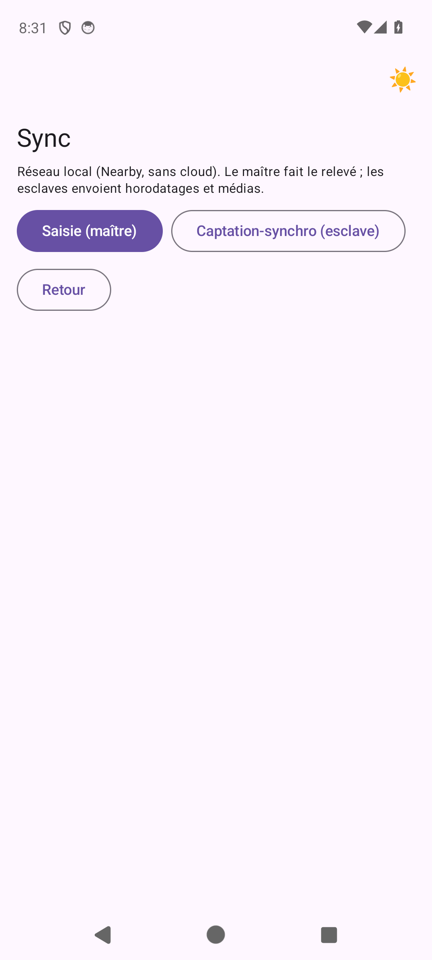
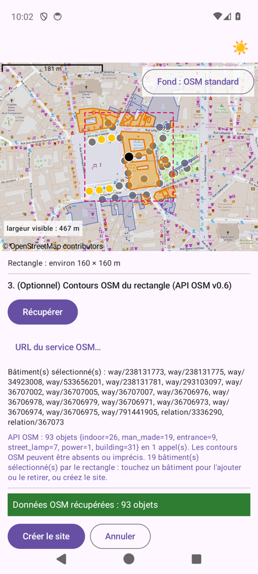
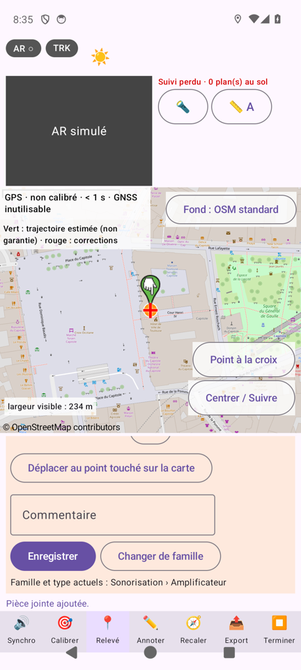
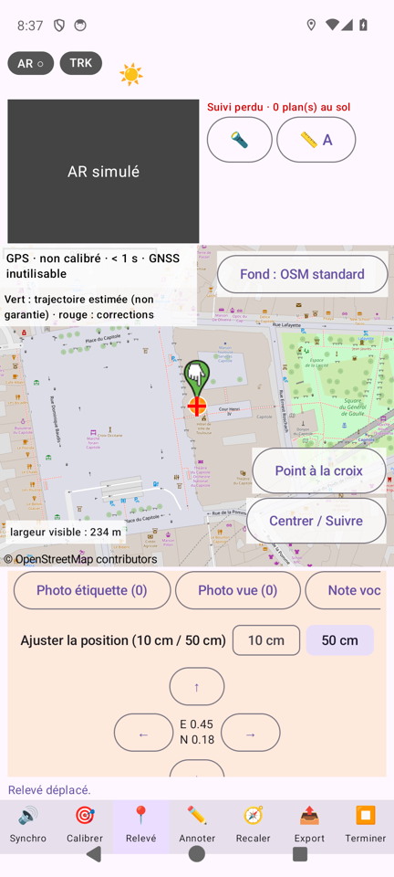
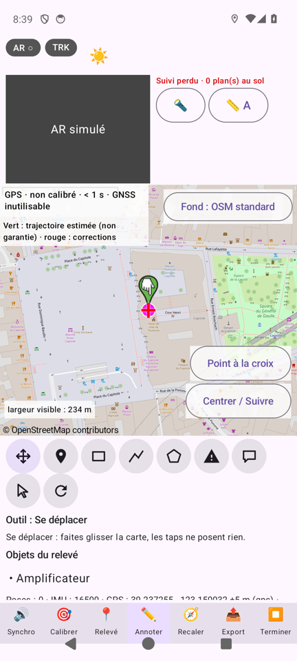

# Compte rendu v176a — correctifs simples (15/11/2026)

Branche `etape-3-v176a-correctifs`, empilée sur `etape-3-paquet3-flows`. PR : https://github.com/Gabrieljean454fgd/eclairage/pull/23 (vers `etape-3-paquet3-flows`, non fusionnée).

## Fait
| ID | Correction | Preuve |
|---|---|---|
| — | `docs/PROPOSITIONS.md` § 17 : Annexe A (parties 1 et 2) | commit `f9770e2` |
| A1 | Accueil : « Sync » ; titre de l'écran Sync | flow `v176_accueil_sync` |
| A2 | Nouveau site : bandeau orange (chargement) / vert « Données OSM récupérées : N objets » / rouge (échec) au-dessus de « Créer le site » ; un échec après un succès repasse au rouge | flow `v176_nouveau_site_osm_ok` (réseau OSM) |
| A3 | « Photo étiquette (n) », « Photo vue (n) », « Note vocale (n) » ; le panneau reste ouvert sur l'objet après une photo | flow `v176_detail_compteurs` (vraie photo émulateur), test `SurveyEditsTest` |
| A4 | Croix ↑↓←→ « Ajuster la position (10 cm / 50 cm) », valeur E/N affichée ; détails et défilement conservés après chaque appui | flow `v176_detail_decalage` (↑ = +0,10 m N ; 50 cm → = +0,50 m E) |
| A5 | « Famille et type actuels : Sonorisation › Amplificateur » | flow `v176_detail_compteurs` |
| A6 | En-tête « Photos et sons (n) » au lieu de « n pièce(s) jointe(s) » | flow `v176_detail_compteurs` |
| A7 | Ouvrir Annoter ferme le relevé ouvert | flow `v176_annoter_ferme_releve` |
| A8 | Note vidée = effacée (`SurveyEdits.note`) | test `SurveyEditsTest` |
| A9 | `docs/DECISIONS.md` (D1–D12, P-D13…, DS1–DS3, glossaire), `docs/ROADMAP_ETAPES.md` | relecture |
| A10 | `session.json` : `trajectoryLengthM`, `posesWithoutCalibration`, `trackingStateCounts` calculés (`TrajectoryCorrector.summarize`) ; avant : `0.0`, `0`, `{}` écrits en dur dans `ResumableExport` | test `ResumableExportTest.sessionJsonSummaryHasTrajectoryLengthAndTrackingCounts` : 0.0 avant, 10,770 m après |

CI : le tag de pré-release suit le paquet (`etape3-v176a-<hash>`, APK `lumisite-etape3-v176a-v<versionCode>-<hash>.apk`).

## Captures (AVD Pixel 7, API 34, navigation à 3 boutons)
| Accueil | Nouveau site | Détails : compteurs | Détails : croix | Annoter |
|---|---|---|---|---|
|  |  |  |  |  |

## CI et pré-release
- CI verte sur `a8d2818` : https://github.com/Gabrieljean454fgd/eclairage/actions/runs/43767044181 (tests JVM, APK, tous les flows Maestro existants + les 5 flows v176a, mise à jour v175 → v176a, réinstallation `adb install -r`).
- Pré-release : https://github.com/Gabrieljean454fgd/eclairage/releases/tag/etape3-v176a-a8d2818 — `lumisite-etape3-v176a-v180-a8d2818.apk` (versionCode 180, clé de test publique).
- Premier passage CI (`b693cc4`) : seul `v176_nouveau_site_osm_ok` a échoué. La réponse OSM (93 objets) allonge le formulaire et repousse le bandeau sous l'écran. Le flow descend maintenant jusqu'au bandeau ; l'application est inchangée.

## Reste
- P-D17…P-D28 : intitulés absents du dépôt, à fournir par Sébastien (`docs/DECISIONS.md`).
- Barre d'actions de Session : libellé « Synchro » inchangé (A1 vise l'Accueil) ; à aligner si Sébastien le souhaite.
- Tests Pixel 7 + Xiaomi 13T Pro : à faire par Sébastien sur la pré-release.
- Suivant : v176b (fluidité de la carte).
