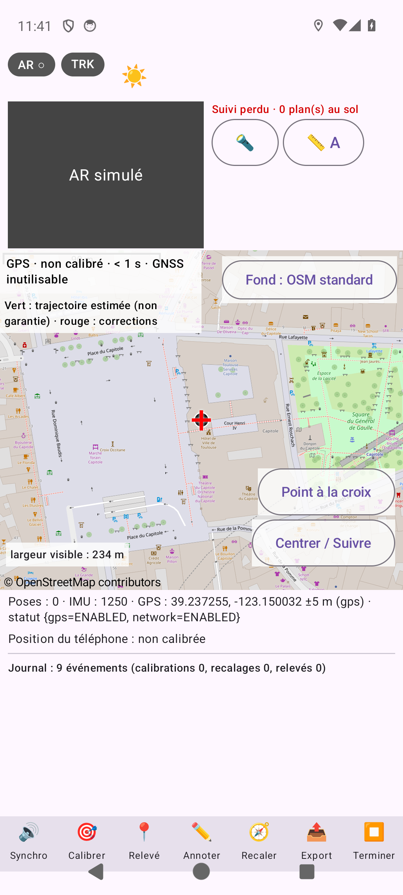
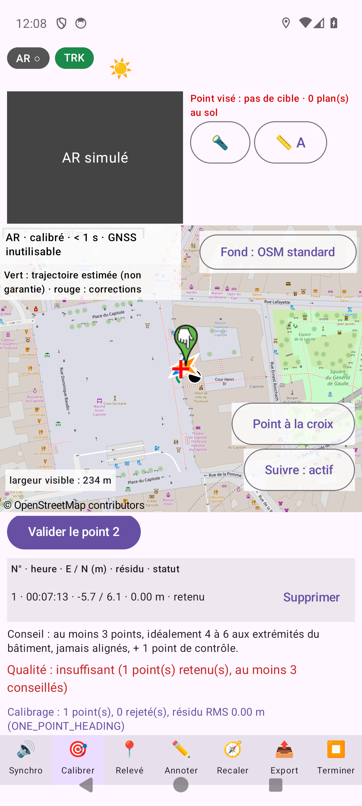

# Compte rendu v176b — fluidité (16/11/2026)

Branche `etape-3-v176b-fluidite`, empilée sur `etape-3-v176a-correctifs`. PR : https://github.com/Gabrieljean454fgd/eclairage/pull/24 (non fusionnée).

## Fait
- **Session > carte** : `MapView` ne vide plus `mv.overlays` à chaque pose. Chaque groupe de calques (bâtiments OSM, rectangle, trajectoire, tracés, repères, secteur, flèches, point choisi) n'est reconstruit que si son contenu change. La flèche du téléphone et le point courant sont déplacés, sans être recréés.
- **Trajectoire** : chaque segment est une `Polyline` mise à jour en place. Pour l'affichage seulement, Douglas–Peucker incrémental par blocs de 500 poses à 5 cm (`core/map/Simplify.kt`). Le journal et les exports gardent toutes les poses.
- **Pose affichée à ≤ 10 Hz** : l'état de l'écran reçoit la pose au même rythme que le journal (100 ms). Le calibrage et le relevé utilisent toujours la dernière image ARCore.
- **Pause** : l'arrêt des capteurs se fait sur le fil appelant. L'écriture disque (fsync), la rotation des segments et la copie vers Documents passent sur le fil `lumisite-session-io`.
- **Terminer** : la session est fermée en arrière-plan et l'écran Site s'affiche tout de suite.
- **Reprendre** : attend la fin de la fermeture, jusqu'à 45 s. Au-delà, la reprise est refusée avec un message, jamais deux écrivains sur la même session.
- **Copie vers Documents** : le parcours du dossier se fait sur le fil de copie. Le SHA-256 d'un fichier fermé est calculé une seule fois, puis mémorisé avec sa taille et sa date (`mirror_stamps.json`, `core/journal/MirrorLedger.kt`). Si la taille ou la date change, le fichier est re-haché.
- **Tests JVM** : `FluiditeTest`, 4 tests. La suite `:core:test` passe : 172 tests.
- **Flow Maestro** : `v176_terminer_rapide`. L'écran Site doit être visible moins de 3 s après « Terminer », puis « Reprendre » rouvre la session.

## Revue automatique (2 cas, corrigés)
- **Reprise trop tôt :** « Reprendre » pouvait ouvrir la session pendant que la fermeture écrivait encore (attente limitée à 10 s). Elle attend maintenant jusqu'à 45 s, sinon elle refuse avec un message.
- **Copie après un arrêt :** un arrêt de l'appli entre l'enregistrement de la date et celui de l'empreinte pouvait faire sauter un fichier modifié. L'empreinte est maintenant enregistrée avant la date.

## Mesure `adb shell dumpsys gfxinfo app.lumisite.android`
Conditions : émulateur Pixel 7 API 34, rendu logiciel swiftshader. Session calibrée par `scenario_p2_calibrage_multipoints`, poses simulées, mesure sur 60 s.

| | v176a (`a8d2818`) | v176b |
|---|---|---|
| Images rendues | 1439 | 1402 |
| Janky frames (legacy) | 1194 (82,97 %) | 572 (40,80 %) |
| Janky frames | 1086 (75,47 %) | 990 (70,61 %) |
| Percentiles 50 / 90 / 99 | 32 / 48 / 65 ms | 22 / 32 / 40 ms |

- **Compteur legacy :** le critère « au moins −50 % » est atteint (−51 %).
- **Compteur récent (« Janky frames ») :** −6 % seulement. Sur cet émulateur, la vue caméra GL est rendue en logiciel et dépasse le budget de 16 ms presque à chaque image.
- **Mesure de référence :** la mesure qui fait foi reste celle du Pixel 7.

## CI et pré-release
- CI verte sur `507e60c` : https://github.com/Gabrieljean454fgd/eclairage/actions/runs/43777740036. Elle couvre :
  - les tests JVM et l'APK ;
  - les 29 flows Maestro, tous réussis au 1er essai, dont `v176_terminer_rapide` ;
  - la mise à jour v176a → v176b ;
  - la réinstallation `adb install -r`.
- Pré-release : https://github.com/Gabrieljean454fgd/eclairage/releases/tag/etape3-v176b-507e60c, APK `lumisite-etape3-v176b-v185-507e60c.apk` (versionCode 185, clé de test publique).

## Captures (AVD Pixel 7, API 34)
| Session reprise après « Terminer » (flow v176_terminer_rapide) | Session > carte calibrée, poses simulées |
|---|---|
|  |  |

## Reste à faire
- Sébastien, sur Pixel 7 :
  - marche de 30 min sans saccade visible ;
  - « Terminer » en moins de 1 s, sans ANR ;
  - mesure `gfxinfo` avant/après sur le téléphone.
- Pendant la fermeture en arrière-plan (quelques secondes), « Accueil > Exporter » n'attend pas la fin de la fermeture, contrairement à « Reprendre ». Le dernier segment pourrait manquer à l'export. Cas non reproduit, donc non corrigé.
- Suite : v176a-bis (Nouveau site, rectangles).
