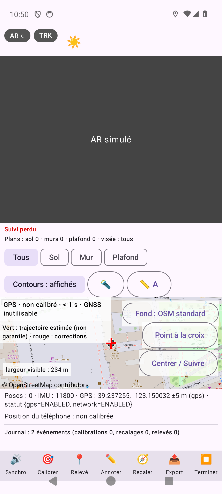

# Compte rendu v176c — AR dépouillée (décision 3)

Branche `etape-3-v176c-ar-depouillee`, empilée sur `etape-3-v176a-bis-rectangles` (PR vers cette branche, non fusionnée).

## Fait
- **Caméra pleine largeur** : cadre 4:3 sur toute la largeur en portrait ; visée, plans, contours, torche et mesure **en dessous**. Panneau ouvert (Calibrer, Relevé…) : même largeur, cadre recadré 2:1 pour laisser la place au panneau et à la carte. Plus aucun texte dans l'image (l'état du calibrage passe sous la caméra) ; seul le réticule reste dessiné.
- **Traits seuls** : `HORIZONTAL_AND_VERTICAL` ; contours des plans en `GL_LINE_LOOP`, arêtes verticales des murs, sans remplissage ni nuage de points. Interrupteur « Contours » et compteurs « Plans : sol · murs · plafond ».
- **Ancres locales** (`Session.createAnchor`) : drapeau orange à chaque point de calibrage/recalage, symbole du luminaire (cercle + croix) à chaque relevé visé ; dessinés seulement quand l'ancre est suivie (`TRACKING`), donc ils réapparaissent quand on revient vers eux.
- **Visée** : sol, mur (`VERTICAL`) et plafond (`HORIZONTAL_DOWNWARD_FACING`), plan le plus proche d'abord ; choix « Tous / Sol / Mur / Plafond » au relevé. **Plus de repli à 50 cm** : sans plan visé, « Position à compléter » et le relevé est refusé (toucher la carte reste possible).
- **Calibrage sur le point visé au sol** (réticule), plus sur la pose du téléphone ; point visé journalisé (`aimSession`, `aimSource`). Poses simulées (debug/CI) : pose du téléphone, comme avant.
- **Résidu par point** dans le tableau ; **5e point = contrôle indépendant** (hors calcul, écart affiché) ; alerte au-delà de 0,5 m ; qualité alignée sur le résidu de chaque point et du contrôle.
- `NOTICE` : attribution du sample ARCore `hello_ar_java` (Apache-2.0), comportement réimplémenté ; pas de SceneView/Filament.

## Tests
- JVM : `AimTest` (plafond, mur, plus proche, « à compléter »), `ArGeometryTest` (projection monde→écran, arêtes verticales, drapeau, symbole), `CalibrationControlTest` (5e point, qualité/résidu). Suite core : 182 tests.
- Maestro : `v176_ar_pleine_largeur`, `v176_ar_contours` + flows existants de Session (Annoter, calibrage multipoints, recaler quand même, même point carte, reprise, relevé sans blocage).

## Captures (émulateur, bloc caméra simulé)

## Reste / à vérifier au téléphone
- Le rendu réel (traits, arêtes, drapeaux, symboles, réapparition des ancres) n'est pas testable sur émulateur (pas d'ARCore) : à vérifier sur Pixel 7.
- La carte de Session est plus petite en portrait (caméra prioritaire, décision 3).

## CI / pré-release
- PR : https://github.com/Gabrieljean454fgd/eclairage/pull/26 (vers v176a-bis, non fusionnée).
- CI verte (APK, tests JVM, tous les flows Maestro, release) : https://github.com/Gabrieljean454fgd/eclairage/actions/runs/43981089089
- Pré-release : https://github.com/Gabrieljean454fgd/eclairage/releases/tag/etape3-v176c-2837aa8 — APK `lumisite-etape3-v176c-v199-2837aa8.apk`, versionCode 199.

## Revue automatique (4 cas, tous corrigés)
- Calibrage à 1 point : l'ancre du point visé effaçait la rotation de la caméra (cap faux) → l'ancre garde la rotation de la caméra (3bcda74).
- « Recaler quand même » : le point forcé prenait la position du téléphone → il garde le point visé (1caa46e).
- 5e point de contrôle : la suppression d'un point antérieur le faisait entrer dans le calcul → rôle journalisé à l'enregistrement, `independentControl` (003618f).
- Visée Mur / Plafond sans plan : un sol estimé était enregistré → « position à compléter » (2837aa8, test JVM).
