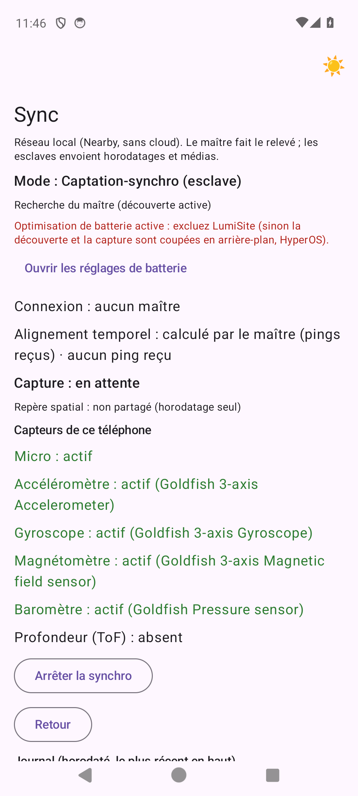
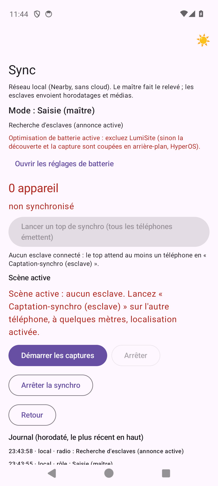

# Compte rendu v176d — Sync maître/esclave réelle (17/11/2026)

Branche `etape-3-v176d-synchro-reelle`, empilée sur `etape-3-v176c-ar-depouillee` (PR vers v176c, non fusionnée).

## Fait (§ 17, v176d)
- **D1 — top de synchro par Nearby.** Accueil > Sync > Saisie (maître) : « Lancer un top de synchro (tous les téléphones émettent) ». Le maître envoie `SyncRound` (fenêtre 12 s, compteur) à chaque esclave connecté ; chacun lance `AudioSync.round` (écoute 12 s, émet son chirp + identifiant à un instant aléatoire) et renvoie `SyncResult` (chirps entendus, horodatage monotone). Session > Synchroniser fait la même chose quand la synchro maître tourne.
- **D3 — résultat par téléphone.** Calcul BeepBeep dans `core` (`SyncRoundCalc`) : décalage = ((tB(A)+tB(B)) − (tA(A)+tA(B)))/2, la propagation s'annule. Affichage « Xiaomi 13T Pro : entendu, décalage 12,3 ms ± 1,0 », ou la raison exacte (non entendu, entendu dans un seul sens, échec audio). L'incertitude (1 ms) est une borne prudente, pas un σ mesuré.
- **D2 — écran Sync verbeux.** Par esclave : connexion, alignement (pings), âge du dernier message, résultat du top, capteurs actifs. Ping toutes les 5 s, « perdu » après 15 s (maître) ; côté esclave, maître silencieux 15 s → déconnexion, nouvelle découverte, reconnexion automatique. Journal horodaté (HH:mm:ss) visible des deux côtés, aussi dans `synchro.ndjson`.
- **D4 — capteurs de l'esclave.** Au démarrage : micro, accéléromètre, gyroscope, magnétomètre, baromètre, profondeur (capacité `DEPTH_OUTPUT` de la caméra). Liste affichée (absents compris), journalisée, envoyée au maître (`Sensors`) ; les capteurs de mouvement et le baromètre sont enregistrés dans `capteurs.csv` (`t_mono_ns,capteur,x,y,z`). La profondeur est seulement détectée, pas enregistrée.
- **D5 — « Scène active »** (maître) : esclaves avec rôle, capture, médias reçus, capteurs ; sans esclave, message explicite.
- **D6 —** « Estimer l'écart avec l'export d'un autre appareil » retiré de Session > Synchro (le calcul reste dans `core/` pour le bureau).
- **HyperOS —** message explicite si la localisation est coupée, si `BLUETOOTH_SCAN` / `NEARBY_WIFI_DEVICES` manquent ou si l'optimisation de batterie n'est pas exclue, avec un bouton vers les réglages de batterie.

## Tests
- JVM : `SyncRoundTest` (6 tests : BeepBeep sur signaux synthétiques, écoute à sens unique, aller-retour du protocole `SyncRound`/`SyncResult` dans `MasterMesh`, résultat périmé ignoré, ping 5 s / perdu 15 s, capteurs, messages de prérequis). `SyncMeshTest` adapté aux nouveaux délais.
- Flows : `v176_sync_esclave_capteurs` (liste des capteurs), `v176_sync_scene_active` (0 esclave → message clair) ; flows Sync existants repassés en local (`scenario_p2b_synchro_sans_esclave`, `scenario_p2_synchro_audio_garde`, `v176_accueil_sync`).

## Limites
- Nearby ne fonctionne pas entre émulateurs : le top à deux téléphones (chirps audibles, « 2 appareils », décalage), la perte Wi-Fi et la reconnexion restent à vérifier par Sébastien sur Pixel 7 + Xiaomi 13T Pro.
- Le micro de l'esclave peut être occupé par une capture en cours pendant un top : l'échec est alors renvoyé et affiché, pas masqué.
- `clock_offset_ms` de l'export n'est pas encore rempli par le résultat du top.

## Revue automatique (Devin Review) — 4 points, tous corrigés
- Fenêtre d'écoute reçue d'un maître : bornée à 3–30 s (`2de8eab`).
- Échéance du ping réinitialisée après une reconnexion, plus de « perdu » immédiat (`6b85652`).
- Chirp de l'esclave absent de son propre enregistrement : « décalage non calculable » explicite, distinct d'une écoute à sens unique (`de507ce`).
- Micro refusé : message et bouton d'autorisation au lieu d'une synchro muette (`e22bdb3`).

## CI / pré-release (22/11/2026)
- CI verte : [run 45036514073](https://github.com/Gabrieljean454fgd/eclairage/actions/runs/45036514073) (APK, tests JVM, tous les flows Maestro, mise à jour depuis le build 199, release).
- Pré-release **build 206** : [etape3-v176d-447d10d](https://github.com/Gabrieljean454fgd/eclairage/releases/tag/etape3-v176d-447d10d), APK `lumisite-etape3-v176d-v206-447d10d.apk`.
