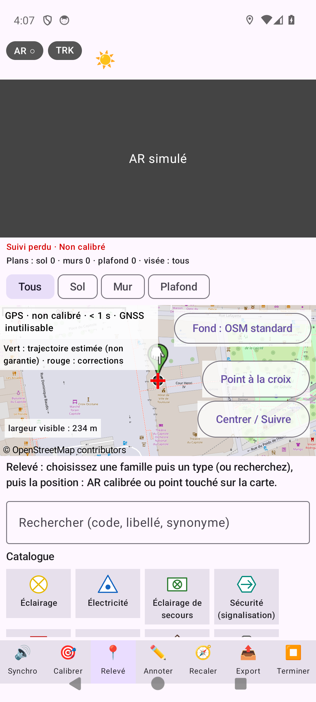
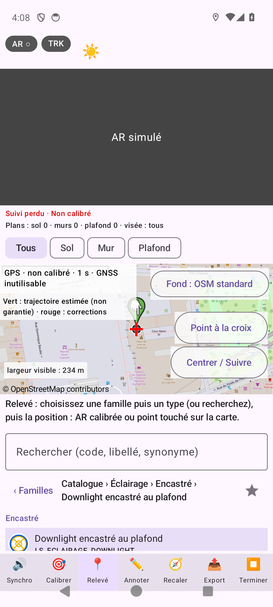
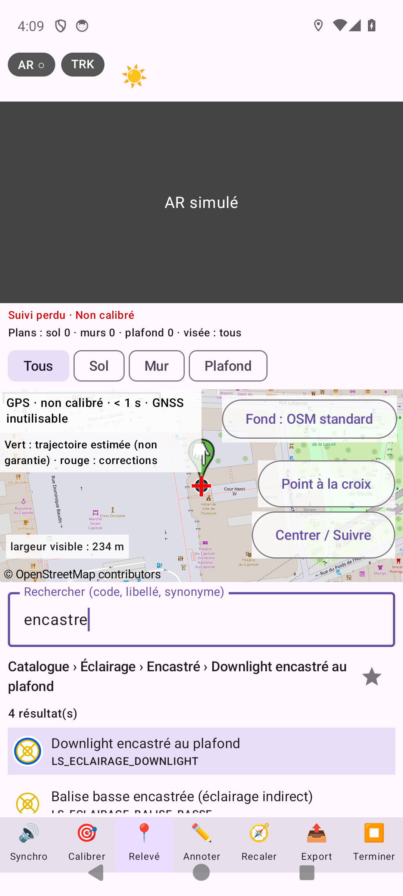
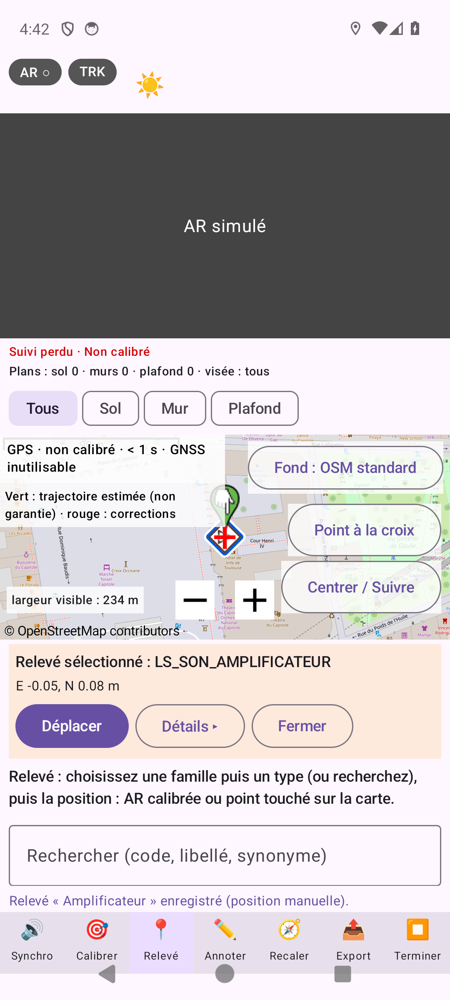
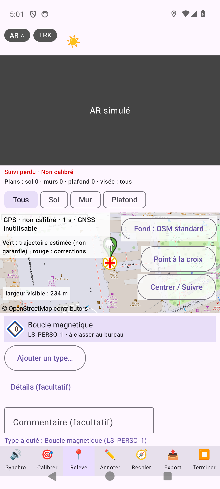

# Compte rendu v176e — menu bloc : catalogue 2.0, symboles d'implantation, ajout de type (22/11/2026)

Branche `etape-3-v176e-menu-bloc`, empilée sur `etape-3-v176d-synchro-reelle` (PR vers v176d, non fusionnée).
Priorité 1 du message du 22/11 : écrans Session > Relevé et Session > Annoter > Poser.

## Fait
- **Catalogue 2.0** (`catalog/lumisite_catalog_2.json`) : codes `LS_*` (les 78 codes de l'Annexe B, la famille SON,
  `LS_AUTRE_A_CLASSER` et les nouveaux codes E3). Chaque entrée : code, libellé français accentué, famille, sous-famille,
  calque bureau `LUMI-*`, `bloc_dwg`, alias des anciens `block_name`, identifiant de symbole. Familles dans l'ordre
  Éclairage, Électricité, Secours, Sécurité, Incendie, Caméra, Son, Autre. `LS_SON_DIFFUSEUR_SONORE_RADIO` porte un
  commentaire « provisoire, à confirmer par Sébastien ». `catalog/correspondance_dwg.json` reste lu au bureau seulement ;
  l'appli enregistre le code `LS_*`. Les anciennes sessions (noms de blocs 0.x) sont relues par alias, sans réécriture.
- **Symboles d'implantation** : bibliothèque originale décrite en primitives pures (`core/catalog/PlanSymbols.kt` :
  cercles, traits, polygones, arcs, cadre par famille) et rendue en Canvas (`ui/PlanSymbolView.kt`). Une forme par famille
  (cercle à croix, triangle, rectangle BAES, hexagone, carré, corps de caméra + cône, losange, octogone) et un glyphe par
  sous-famille (encastré, spot, réglette, applique, prise, interrupteur, tableau, extincteur, déclencheur manuel…).
  Même dessin dans le sélecteur (32–36 dp) et sur la carte (44 dp). Sélection : halo blanc + trait bleu, l'objet garde
  sa forme et sa couleur. Le drapeau orange reste réservé aux repères.
- **Sélecteur unique** pour Relevé et Annoter > Poser : recherche (code, libellé, synonymes, sans accents), fil d'Ariane,
  favoris (étoile) et 12 récents en tête, grille des familles avec symbole, puis types de la famille avec symbole et
  libellé. Downlight en 3 appuis : Éclairage › Downlight › Enregistrer le relevé.
- **« Ajouter un type… »** : crée `LS_PERSO_<n>` (`is_block = false`, « à classer au bureau ») dans la famille ouverte,
  stocké à part dans `files/catalog/types_perso.json` (le catalogue livré n'est pas modifié). Le type apparaît ensuite dans
  sa famille, dans la recherche et dans l'export (`code`, `famille`, `label`, `a_classer_au_bureau` dans le GeoJSON).
- **Photo après pose** : après « Enregistrer le relevé » et après une pose dans Annoter > Poser, la prise de photo
  s'ouvre, rattachée à l'objet. Réglage « Photo après pose (Session > Relevé et Annoter > Poser) », activé par défaut.

## testTags ajoutés
`session_releve_recherche`, `session_releve_fil_ariane`, `session_releve_categorie_<FAMILLE>`, `session_releve_type_<CODE>`,
`session_releve_recent_<CODE>`, `session_releve_favori_basculer`, `session_releve_retour`, `session_releve_resultats`,
`session_releve_ajouter_type`, `session_releve_nouveau_type_nom`, `session_releve_nouveau_type_valider`,
`session_releve_nouveau_type_annuler`. Les anciennes puces `session_annoter_famille_<bloc>` disparaissent ; les flows
existants qui les visaient passent par Son › Amplificateur (même critère métier). Les flows de mise à jour
(`maj/maj_avant.yaml`, `maj/v6_releve.yaml`) acceptent les deux catalogues, car ils tournent aussi sur la version précédente.

## Tests
- JVM : `CatalogTest` (unicité, ASCII, ≤ 31 caractères, 78 codes + SON + E3, 25 blocs DWG, alias des anciens noms,
  recherche sans accents, fil d'Ariane), `PlanSymbolsTest` (symbole connu pour chaque entrée, pas de drapeau dans le
  catalogue, forme et couleur distinctes par famille, primitives dans la boîte unité, `LS_PERSO_n`),
  `GeoJsonExportTest.customTypeIsExportedWithItsLabel`.
- Flows : `b199_releve_catalogue` (3 appuis, photo aussitôt, « encastre », ajout de type, Annoter > Poser + photo),
  `v176_catalogue_navigation`, `v176_catalogue_recherche`, `v176_symbole_selection` ; flows de relevé existants adaptés.

## Limites
- Maestro ne saisit pas les accents (`inputText`) : le flow cherche « encastre » ; « encastré » est couvert par le test JVM.
- En portrait, la grille des familles tient sur deux rangées sous la carte : Son, Caméra, Incendie et Autre demandent un
  glissement. La carte plus grande et la caméra repliée viennent avec v176g (point 3).
- « E2 » (note audio maintenue, tag horodaté sur l'audio continu) n'est pas modifié par ce paquet.

## CI / pré-release
À compléter.
